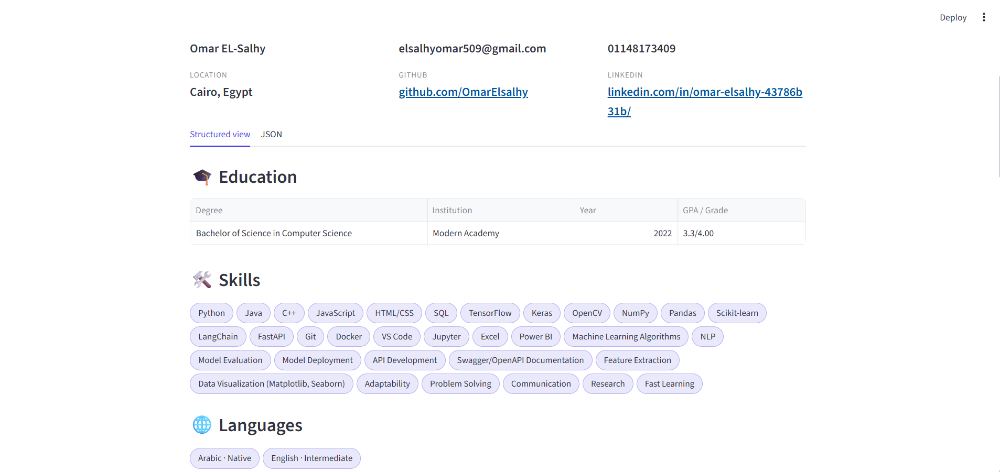

# 📄 HR Candidate Profile Parser

[](https://github.com/OmarElsalhy/hr-candidate-profile-parser/actions)


Turn a resume into a clean, structured JSON profile. A small open-source LLM runs **locally on your machine** and LangChain's `StructuredOutputParser` enforces a fixed schema, so no resume data is ever sent to an external API.



## Features

- **Upload a PDF / TXT** file or paste the resume text
- **Full profile:** name, email, phone, location, GitHub and LinkedIn links, education (with **GPA / grade**), skills, spoken languages, work experience (role, company, years and the **bullet points under each job**) and **projects**
- **Clean results view** with tables, skill chips and cards, plus the raw JSON with one-click download
- **Fast:** the model only writes what needs understanding (name, education, job titles...). Contacts, skills, job bullets and projects are read straight from the resume text by code, so the answer is short
- **Reliable:** values that don't appear in the resume (grades, languages, skills, contacts, locations) are dropped, and skills are collected from **every** skills category
- **PDF-aware:** bullets that extract as a lone "●" line are rejoined, and hyperlinks hidden behind words like "GitHub" are read
- **Private:** everything runs locally, on **CUDA, Apple Silicon (MPS) or CPU**, picked automatically
- **Tested:** unit tests for parsing, extraction and the UI, with CI on every push

## Example

Input:

```text
John Smith
Email: john.smith@email.com | Phone: +1 555 123 4567
Location: Boston, USA
GitHub: github.com/johnsmith | LinkedIn: linkedin.com/in/johnsmith
Education
B.Sc. Computer Science, MIT, 2020 (GPA: 3.8/4.0)
Technical Skills
Languages: Python, SQL
Developer Tools: Git, Docker
Skills: Machine Learning, Data Analysis
Languages
English (Native), Arabic (Fluent)
Experience
Software Engineer — Google 2020 – 2023
● Built internal data pipelines in Python.
● Cut report generation time by 40%.
Data Scientist — OpenAI 2023 – Present
● Trained and evaluated ranking models for search.
Projects
Resume Parser — LangChain and Streamlit app
● Extracts structured profiles from PDF resumes.
● Runs fully offline on a local GPU.
```

Output:

```json
{
  "full_name": "John Smith",
  "email": "john.smith@email.com",
  "phone": "+1 555 123 4567",
  "location": "Boston, USA",
  "github": "github.com/johnsmith",
  "linkedin": "linkedin.com/in/johnsmith",
  "education": [
    {
      "degree": "B.Sc. Computer Science",
      "institution": "MIT",
      "year": 2020,
      "grade": "3.8/4.0"
    }
  ],
  "skills": [
    "Python",
    "SQL",
    "Git",
    "Docker",
    "Machine Learning",
    "Data Analysis"
  ],
  "languages": [
    {
      "language": "English",
      "level": "Native"
    },
    {
      "language": "Arabic",
      "level": "Fluent"
    }
  ],
  "experience": [
    {
      "role": "Software Engineer",
      "company": "Google",
      "years": "2020 – 2023",
      "highlights": [
        "Built internal data pipelines in Python.",
        "Cut report generation time by 40%."
      ]
    },
    {
      "role": "Data Scientist",
      "company": "OpenAI",
      "years": "2023 – Present",
      "highlights": [
        "Trained and evaluated ranking models for search."
      ]
    }
  ],
  "projects": [
    {
      "name": "Resume Parser",
      "description": "LangChain and Streamlit app",
      "highlights": [
        "Extracts structured profiles from PDF resumes.",
        "Runs fully offline on a local GPU."
      ]
    }
  ]
}
```

Only `full_name` is required. Anything that isn't in the resume comes back as `""` or `[]`.

## Quick start

**Requirements:** Python 3.10 - 3.12 and, for reasonable speed, an NVIDIA GPU with about 4 GB of free memory.

```bash
git clone https://github.com/OmarElsalhy/hr-candidate-profile-parser.git
cd hr-candidate-profile-parser

python -m venv .venv
source .venv/bin/activate        # Windows: .venv\Scripts\activate
pip install -r requirements.txt

python -m streamlit run app.py
```

The app opens at <http://localhost:8501>.

- The first start downloads the model (about 3 GB) and caches it under `~/.cache/huggingface`. Later starts only load it from disk, which takes a few seconds.
- The model is loaded once when the page opens, so every parse starts immediately.
- Use `python -m streamlit` (not just `streamlit`) so the app runs with the Python environment you activated.

> **NVIDIA GPU on Windows:** `pip install torch` often installs a CPU-only build. Install the CUDA build from [pytorch.org](https://pytorch.org/get-started/locally/) first, then run `pip install -r requirements.txt`. You can check with `python -c "import torch; print(torch.cuda.is_available())"`, which should print `True`.

## How it works

```text
resume text / PDF
      │  hr_parser/extract.py     read text and PDF links, rejoin bullets
      ▼
prompt = template + schema format instructions      hr_parser/schema.py
      │
      ▼
local LLM (chat template, greedy decoding)          hr_parser/llm.py
      │
      ▼
first valid JSON block → StructuredOutputParser → normalize
      │
      ▼
checked and completed against the resume text       hr_parser/contacts.py
(contacts, skills, job bullets, projects, grades)   hr_parser/sections.py
      │
      ▼
Streamlit UI (tables, chips, JSON download)         app.py
```

**Why not let the model write everything?** Small models are slow and unreliable at copying long lists: they skip skill categories, drop bullets and sometimes invent details. So the model handles what needs understanding, and plain code reads the rest from the text and checks the model's answer against it.

## Configuration

The default model is `Qwen/Qwen2.5-1.5B-Instruct` (about 3 GB), which fits small GPUs. Settings are environment variables, so the UI stays simple for end users:

| Variable | Purpose | Example |
| --- | --- | --- |
| `HR_PARSER_MODEL` | Use another Hugging Face instruct model | `microsoft/Phi-3-mini-4k-instruct` |
| `HR_PARSER_DEBUG` | `1` shows the extracted text and raw model output in the page | `1` |

```bash
# Windows (cmd):        set HR_PARSER_MODEL=microsoft/Phi-3-mini-4k-instruct
# Windows (PowerShell): $env:HR_PARSER_MODEL="microsoft/Phi-3-mini-4k-instruct"
# macOS / Linux:        export HR_PARSER_MODEL=microsoft/Phi-3-mini-4k-instruct
python -m streamlit run app.py
```

Larger models are usually more accurate but need more GPU memory (Phi-3 mini needs roughly 8 GB). On CPU, expect a minute or more per resume.

## Project structure

```text
├── app.py                  # Streamlit UI
├── hr_parser/
│   ├── schema.py           # schema, prompt, JSON extraction, normalization
│   ├── sections.py         # bullet cleaning, skills, job bullets, projects, grades
│   ├── contacts.py         # regex for email, phone, GitHub, LinkedIn; location check
│   ├── extract.py          # PDF / TXT reading, including PDF hyperlinks
│   └── llm.py              # model loading and generation
├── tests/                  # pytest suite (the model is mocked)
├── .streamlit/config.toml  # theme
├── .github/workflows/      # CI
├── requirements.txt
└── requirements-dev.txt
```

## Tests

```bash
pip install -r requirements-dev.txt
pytest
```

The tests mock the model, so they run in seconds and need no GPU or download.

## Troubleshooting

| Problem | Fix |
| --- | --- |
| `No module named streamlit` | You are running a different Python from the one you installed into. Activate your environment, then use `python -m streamlit run app.py`. |
| Model download is extremely slow on Windows (kilobytes per second) | Disable the `hf-xet` downloader before starting the app: `set HF_HUB_DISABLE_XET=1`. |
| Parsing is very slow | Check `python -c "import torch; print(torch.cuda.is_available())"`. `False` means PyTorch is running on the CPU; install the CUDA build. |
| "We couldn't read this resume" | The model's answer wasn't valid JSON. Start the app with `HR_PARSER_DEBUG=1` to see the extracted text and raw output. The raw output is also printed in the terminal. |
| A scanned PDF gives no text | Image-only PDFs have no text layer and need OCR first. |

## Limitations

- The output is generated by a small language model and can be wrong or incomplete. A person should always review it, and it shouldn't be the sole basis for hiring decisions.
- Skills, job bullets and projects are found by their headings (for example "Technical Skills", "Experience", "Projects"). Unusual layouts, such as multi-column PDFs, may be read out of order.
- Job bullets are matched to a job through the title and company on its heading line. If that can't be matched, the job's bullets are left empty.
- A "Languages:" line under Technical Skills is treated as programming languages and goes to skills. "Languages" means spoken languages.
- Resumes longer than 8,000 characters are truncated.
- Tested mainly with English resumes.

## License

MIT, see [LICENSE](LICENSE).
